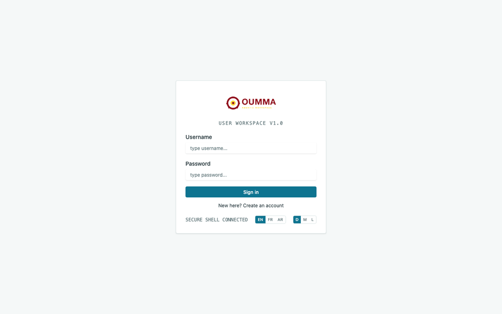
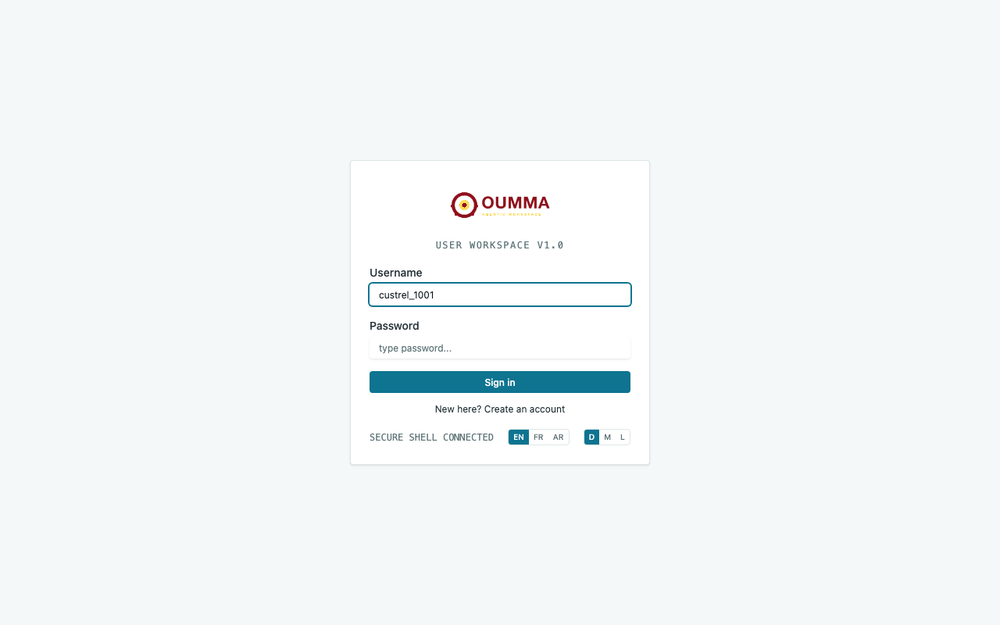

# Oumma — Agentic WorkSpace


**Oumma** is a business platform that turns your day-to-day procedures — onboarding, claims, orders and any other multi-step process — into **guided, AI-assisted digital journeys**. Employees no longer chase paperwork: they open the workspace, see exactly what is waiting for them, and complete each step inside the process — while AI handles the routing, drafting and notifications.

The interface is fully multilingual (**English / French / Arabic**, RTL-aware) and role-aware: every user only sees and can do what their role allows.

---

## Who uses Oumma?

| Profile | What they get |
|---|---|
| **Employees & operators** | A personal workspace: their pending tasks, their dossiers, forms to fill, documents to attach, and an **AI assistant** that answers questions and drafts work for them. |
| **Process owners & managers** | Full visibility on their processes (dossiers in flight, who is on which step, history and audit trail). |
| **Designers** | Everything above **plus** a visual **Process Designer**: build and modify processes by dragging steps on a BPMN canvas — or simply by **talking to the AI** ("add a review step for Managers after the launch form"). |

Users register themselves (email activation by link), sign in through the enterprise identity provider (Keycloak), and — if their account has the **Designer** role — choose between **Designer mode** and **Normal mode** right after every login.

## Login & mode choice

```
[ GIF: sign in → mode orientation dialog → workspace ]
```


## Everyday work: process mode

A normal user's day with Oumma — pick a process, review the dossiers, open the tasks waiting on you:



- **My Processes** — the processes you are allowed to launch or work on, each with its own icon, description and launch role.
- **Create a dossier** — start a process instance by filling its launch form (AI Assist can pre-fill and check it for you).
- **My Dossiers** — every instance you launched or are involved in, with live status and full history.
- **My Tasks** — the concrete steps that are waiting on *you*, with the role-based actions you are allowed to perform (complete, comment, attach, view).
- **Forms** — structured, validated input; required fields are enforced.
- **Documents** — attach and share dossier documents with role-scoped permissions.
- **Notifications** — a bell with everything that happened on your dossiers (new tasks, completions, status changes).
- **AI Assist** — a chat sidebar that launches processes, answers questions about your dossiers and analyses uploaded documents, on your behalf.
- **Transparent AI budget** — every user sees the tokens they consumed this month; a monthly quota protects the organization's LLM costs, with a self-service "request top-up" that emails the administrator.

## Designer mode: shape your processes with AI

Designers open the **Process Design** space. The same process can be edited on the canvas *or* through conversation — the AI proposes the change, you confirm, and it lands in a **pending version** that you deploy when ready (running dossiers keep the version they started with):


What the designer experience includes:

- **Interactive BPMN canvas** — human steps (👤 with their role), system steps (⚙), start/end, and gateway rendering for parallel forks and joins. Click a step to configure it, **drag any step anywhere** to untangle complex designs, connect or join steps, delete or rename them. Four layout algorithms (left→right, top→down, circular, force-directed).
- **AI design chat** — describe the change in plain language; the agent executes it through a safe, confirmed tool set (add/rename steps, roles & permissions, forms, search-item labels, icons, tools, versions…). Deployment and deletion stay **human decisions**.
- **Forms builder** — build the form behind a step (field types, required flags, labels in 3 languages).
- **Roles & permissions** — per-step role assignments, who can complete / comment / attach / view, synced to the identity provider.
- **Search items** — a trilingual label catalog so every UI string in the process can be localized without code.
- **Tool steps (MCP-like)** — plug external systems into the flow as zero-LLM system tasks: **Gmail, Telegram, WhatsApp, generic HTTP/webhooks**, with credentials managed per process.
- **Design versions** — single pending version, automatic semantic versioning (major/minor/patch), deploy or discard from the versions tab, icon picker for the process menu.

## Why teams adopt Oumma

1. **Onboarding without friction** — self-registration with email activation, roles assigned by group, guided first run.
2. **Every step is owned** — a task always names the role responsible; nothing falls between chairs.
3. **AI does the boring parts** — routing, drafting, document analysis and cross-system notifications run as system tasks, **deterministically and with zero token cost** where no intelligence is needed.
4. **Cost visibility** — per-user monthly LLM quotas, a usage ledger and a cost rollup per process; claims are emailed to the admin.
5. **Safe change management** — AI-suggested design changes are confirmed by the designer and deployed as versions; running processes are pinned to the version they started on.
6. **Enterprise identity** — Keycloak single sign-on, group-based authorization enforced server-side on every action (tasks, comments, attachments, design writes).

## Licensing

Apache License 2.0 — see [LICENSE](LICENSE).

## Running the platform

The web app is served by nginx and talks to the **Oumma engine** (see the [`oumma`](../oumma) repository) on a single base URL:

```bash
# development
npm install
npm run dev        # http://localhost:5173

# production image
docker build -t oumma-app .
```

Runtime configuration (backend URLs, service names) is injected at startup via `window.APP_CONFIG` — no rebuild per environment. All LLM endpoints/keys are configured **server-side** in the engine's docker compose; the app never holds an LLM URL.

---

*Built with React 19, TypeScript, Vite, TanStack Query, Tailwind CSS. Workflow execution and AI orchestration: the Oumma engine (Go).*
